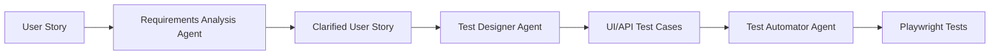

# AI-Driven QA Pipeline

Demo project showing how GitHub Copilot custom agents can support the full QA workflow: requirements analysis, test design, and test automation.

The project combines a TypeScript + Playwright automation framework with three custom Copilot agents that turn a user story into clarified requirements, traceable UI/API test cases, and executable automated tests.

## Application Under Test

The tests target one of the community implementations of the RealWorld app: [realworld-django-rest-framework-angular](https://github.com/thanhdev/realworld-django-rest-framework-angular).

RealWorld is a Medium-like demo application used for comparing frontend, backend, and full-stack implementations across different technology stacks. In this repository it is used as a realistic product surface for demonstrating the QA pipeline.

## Why AI-Driven?

This project uses AI as part of the QA process architecture, not only as an occasional coding assistant. Each agent has a defined role, input, workflow, and output, so the process can be repeated from story to story.

The human QA engineer still reviews decisions, resolves ambiguities, and owns the final quality bar. The agents standardize repetitive analysis and implementation steps, while the Playwright framework keeps the final result executable and maintainable.

## Pipeline Overview



## What This Project Demonstrates

- Agent-driven QA workflow using GitHub Copilot custom agents
- Requirements analysis before implementation starts
- Traceable test design based on acceptance criteria and API contracts
- UI and API test case generation for the RealWorld demo application
- Playwright automation framework written in TypeScript
- Page Object Model for UI tests and API client layer for API tests
- Reusable project conventions through Copilot instructions, agents, and slash commands

## Custom Copilot Agents

The project contains three custom agents in `.github/agents/`.

### Requirements Analysis

Reviews a user story for ambiguity, inconsistency, incompleteness, missing boundaries, weak error handling, and untestable acceptance criteria.

Output includes:

- AC coverage review
- quality findings
- boundary condition gaps
- error handling gaps
- risk matrix
- prioritized BA questions

### Test Designer

Turns a clarified user story into complete, traceable test cases.

The agent designs:

- UI test cases from acceptance criteria
- API test cases from the OpenAPI specification
- one focused E2E scenario per story
- traceability matrix from AC to test cases
- coverage summary and known gaps

### Test Automator

Takes selected test cases and implements verified Playwright tests.

The agent follows the existing automation framework, reuses Page Objects and API clients, validates selectors through Playwright MCP when needed, and runs the relevant tests after implementation.

## Slash Commands

The same workflows can be triggered through slash commands stored in `.github/prompts/`:

| Command | Purpose |
|---------|---------|
| `/analyze` | Run requirements analysis for a user story |
| `/design-tests` | Generate UI/API test cases from clarified requirements |
| `/automate` | Implement Playwright tests from selected test cases |

## Automation Framework

The test automation layer is built with TypeScript and Playwright.

Key framework conventions:

- Page Objects extend `BasePage`
- API clients extend `BaseApiClient`
- UI pages are accessed through `RealWorldPageManager`
- API clients are accessed through `ApiManager`
- tests import fixtures from `src/realworld/base/base-test.ts`
- authenticated contexts are prepared through the Playwright setup project
- tests are tagged with labels such as `@E2E`, `@Smoke`, `@CriticalPath`, and `@Extended`

## Project Structure

```text
.github/agents/       Custom GitHub Copilot agents
.github/prompts/      Slash commands for agent workflows
docs/realworld/       OpenAPI specification and reference docs
user-stories/         Original and clarified user stories
test-cases/           Generated UI and API test cases
src/realworld/ui/     Page Objects and UI page manager
src/realworld/api/    API clients and API manager
src/realworld/base/   Shared Playwright fixtures and base classes
src/realworld/tests/  Automated Playwright tests
```

## Example Flow: Publish Article

The repository includes an example workflow for `US-001: Publish Article`.

1. The initial user story contains broad acceptance criteria and missing boundary details.
2. The Requirements Analysis agent identifies ambiguity, missing constraints, and risk areas.
3. The clarified v2 story defines field limits, validation rules, authorization behavior, error handling, and performance expectations.
4. The Test Designer agent creates UI and API test cases with AC traceability.
5. The Test Automator agent implements selected Playwright tests using the framework conventions.

Relevant artifacts:

- `user-stories/realworld/US-001-publish-article.md`
- `user-stories/realworld/US-001-publish-article-v2.md`
- `test-cases/realworld/articles/US-001/ui/test-cases.md`
- `test-cases/realworld/articles/US-001/api/test-cases.md`
- `src/realworld/tests/articles/us001-publish-article.spec.ts`

## Running Tests

Install dependencies:

```bash
npm install
npx playwright install
```

Create or update `.env` from `example.env`, then make sure the RealWorld app is running at:

```text
http://localhost:8000
```

Refresh authentication state:

```bash
npm run test:setup
```

Run the E2E tests:

```bash
npm run test:e2e -- --reporter=line
```

Run the full Playwright suite:

```bash
npm test
```

Open the Playwright HTML report:

```bash
npm run report
```

## Resume Highlights

- Designed an AI-driven QA pipeline around GitHub Copilot custom agents
- Built a TypeScript + Playwright automation framework for the RealWorld app
- Implemented Page Object and API client abstractions
- Created a repeatable workflow from user story analysis to executable tests
- Demonstrated traceability between requirements, test cases, and automated coverage
- Used agent instructions and slash commands to encode QA process knowledge inside the repository

## Tech Stack

- TypeScript
- Playwright
- GitHub Copilot custom agents
- Playwright MCP
- RealWorld demo application
